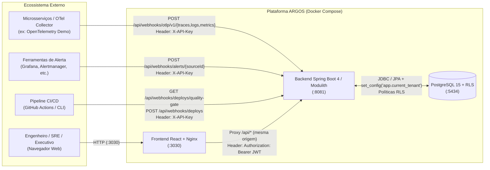
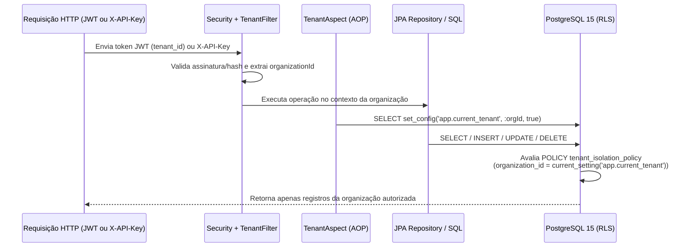

# Documentação Técnica e Arquitetural — Plataforma ARGOS

> **Central de Inteligência Operacional Multi-Tenant para Observabilidade, Gestão de Incidentes e Confiabilidade em Microsserviços (TCC 2026)**

---

## Sumário

1. [O que é o Projeto Argos?](#1-o-que-é-o-projeto-argos)
2. [Visão Macro: Como Tudo se Conecta](#2-visão-macro-como-tudo-se-conecta)
3. [O que são e Como Funcionam as Ferramentas Utilizadas](#3-o-que-são-e-como-funcionam-as-ferramentas-utilizadas)
   - [3.1 OpenTelemetry (OTel) e Protocolo OTLP](#31-opentelemetry-otel-e-protocolo-otlp)
   - [3.2 Spring Boot 4 & Spring Modulith](#32-spring-boot-4--spring-modulith)
   - [3.3 PostgreSQL 15, Flyway e Row-Level Security (RLS)](#33-postgresql-15-flyway-e-row-level-security-rls)
   - [3.4 Spring Security (Autenticação Dual: JWT + X-API-Key)](#34-spring-security-autenticação-dual-jwt--x-api-key)
   - [3.5 React 19, Vite 8 e Nginx (Reverse Proxy)](#35-react-19-vite-8-e-nginx-reverse-proxy)
   - [3.6 Docker, Docker Compose e Testcontainers](#36-docker-docker-compose-e-testcontainers)
   - [3.7 OpenTelemetry Demo (Astronomy Shop) e `flagd`](#37-opentelemetry-demo-astronomy-shop-e-flagd)
   - [3.8 GitHub Actions, Dependabot, Trivy e Quality Gate](#38-github-actions-dependabot-trivy-e-quality-gate)
4. [Arquitetura Interna do Backend (Módulos Spring Modulith)](#4-arquitetura-interna-do-backend-módulos-spring-modulith)
5. [Isolamento Multi-Tenant Ponta a Ponta](#5-isolamento-multi-tenant-ponta-a-ponta)
6. [Fluxos Principais da Aplicação](#6-fluxos-principais-da-aplicação)
   - [6.1 Fluxo de Ingestão de Telemetria (OTLP/HTTP)](#61-fluxo-de-ingestão-de-telemetria-otlphttp)
   - [6.2 Fluxo de Monitoramento Automático e Abertura de Incidente (SLO/Alerts)](#62-fluxo-de-monitoramento-automático-e-abertura-de-incidente-sloalerts)
   - [6.3 Fluxo de Correlação de Causa-Raiz (Topologia + RED + Waterfall + DORA)](#63-fluxo-de-correlação-de-causa-raiz-topologia--red--waterfall--dora)
   - [6.4 Fluxo de CI/CD, Quality Gate e Registro de Deploy](#64-fluxo-de-cicd-quality-gate-e-registro-de-deploy)
7. [Estrutura do Frontend e Mapeamento de Telas](#7-estrutura-do-frontend-e-mapeamento-de-telas)
8. [Infraestrutura, Portas e Como Subir o Ambiente](#8-infraestrutura-portas-e-como-subir-o-ambiente)
9. [Testes Automatizados e Suíte Experimental (Benchmarks)](#9-testes-automatizados-e-suíte-experimental-benchmarks)

---

## 1. O que é o Projeto Argos?

Em arquiteturas modernas baseadas em microsserviços, os dados necessários para resolver uma falha em produção costumam estar espalhados em **ferramentas desconectadas**:
- O alerta dispara em uma ferramenta (ex.: Grafana/Prometheus);
- Os *logs* e *traces* distribuídos ficam em outra;
- O histórico de *deploys* fica no GitHub Actions ou GitLab;
- A comunicação e linha do tempo do incidente ficam em chats ou planilhas.

Essa fragmentação aumenta drasticamente o **MTTA** (*Mean Time to Acknowledge* — tempo médio para reconhecer) e o **MTTR** (*Mean Time to Restore* — tempo médio para restaurar o serviço).

O **Argos** resolve esse problema unificando, em uma **única plataforma multi-tenant**, todo o ciclo de vida operacional:

$$\text{Telemetria OTLP / Alertas} \longrightarrow \text{Detecção / Deduplicação} \longrightarrow \text{Incidente} \longrightarrow \text{Correlação (Deploys + Topologia + RED + Traces)} \longrightarrow \text{Resolução \& Métricas DORA}$$

Principais pilares do projeto:
1. **Observabilidade Nativa OpenTelemetry**: Recebe traces, logs e métricas diretamente via padrão OTLP/HTTP JSON, sem depender de agentes proprietários.
2. **Descoberta Visual de Causa-Raiz**: Desenha o grafo de dependência entre microsserviços a partir dos traces e destaca onde a falha nasceu (causa-raiz) versus quem está apenas sofrendo efeito cascata.
3. **Correlação Automática com Mudanças (DORA + Deploys)**: Cruza automaticamente a abertura de um incidente com deploys recentes no mesmo serviço e calcula as 4 métricas DORA oficiais.
4. **Isolamento Multi-Tenant Real**: Múltiplas organizações compartilham a mesma instância da aplicação com isolamento garantido no motor do banco de dados via **PostgreSQL Row-Level Security (RLS)**.
5. **Prevenção em CI/CD (Quality Gate)**: Bloqueia novos deploys automaticamente caso o serviço tenha um incidente `SEV1` ativo ou um monitor em alerta crítico.

---

## 2. Visão Macro: Como Tudo se Conecta

O diagrama abaixo mostra como os componentes externos (microsserviços, pipelines de CI/CD, fontes de alerta e usuários) se comunicam com o Argos:



### Como funciona a comunicação de rede:
1. **Usuário ↔ Frontend ↔ Backend**: O navegador acessa o **Nginx** na porta `3030`. O Nginx serve os arquivos estáticos compilados do React e encaminha qualquer requisição `/api/*` para o container `backend` na porta `8081` (evitando problemas de CORS, pois para o navegador tudo está na mesma origem).
2. **Sistemas Externos ↔ Backend**: O OpenTelemetry Collector, pipelines CI/CD e webhooks de alerta enviam requisições diretamente para `http://localhost:8081/api/webhooks/...` autenticando-se via cabeçalho HTTP `X-API-Key`.
3. **Backend ↔ PostgreSQL**: O backend persiste e consulta os dados no PostgreSQL 15 usando Flyway para migrações versionadas, Spring Data JPA para entidades transacionais e `JdbcTemplate` para consultas analíticas e inserções em lote de alta vazão.

---

## 3. O que são e Como Funcionam as Ferramentas Utilizadas

### 3.1 OpenTelemetry (OTel) e Protocolo OTLP
* **O que é**: É o padrão aberto da CNCF (*Cloud Native Computing Foundation*) para instrumentação e coleta de telemetria em aplicações distribuídas, unificando os três pilares da observabilidade:
  - **Traces (Rastros)**: Representam o caminho completo de uma requisição através de vários microsserviços. Cada etapa dentro de um serviço é um **Span** (contendo `trace_id`, `span_id`, `parent_span_id`, duração, serviço e status).
  - **Logs**: Registros textuais/estruturados de eventos ocorridos em um serviço, frequentemente vinculados a um `trace_id` e `span_id`.
  - **Metrics (Métricas)**: Medições numéricas agregadas ao longo do tempo (ex.: uso de heap, histogramas de duração HTTP).
* **Como funciona no Argos**:
  - Os microsserviços enviam telemetria para um **OpenTelemetry Collector**, que por sua vez exporta os dados em formato **OTLP/HTTP JSON** para o Argos (`/api/webhooks/otlp/v1/traces`, `/logs` e `/metrics`).
  - O Argos faz o *parsing* nativo dos payloads OTLP (`OtlpJsonParser`), grava em lote no PostgreSQL (`OtlpIngestionService`) e correlaciona automaticamente os spans para montar o **waterfall do trace**, o **grafo de dependências** e os **gráficos RED**.

### 3.2 Spring Boot 4 & Spring Modulith
* **O que são**:
  - **Spring Boot 4.1.1 (Java 17+)**: Framework principal do backend responsável por servidor web embutido (Tomcat), injeção de dependências, segurança, acesso a dados e agendamento de tarefas (`@Scheduled`).
  - **Spring Modulith 2.1.1**: Biblioteca que estrutura um monólito em **módulos lógicos estritamente desacoplados** por domínio de negócio.
* **Como funcionam no Argos**:
  - Em vez de criar vários microsserviços complexos para o próprio Argos, ele usa a arquitetura de **Monólito Modular**.
  - Cada pacote de primeiro nível (`identity`, `incident`, `apikey`, `alerting`, `delivery`, `telemetry`, `shared`) só pode expor suas classes raiz; subpacotes como `.domain` e `.dto` são encapsulados.
  - O teste automatizado `ModularityTests` garante durante o build que nenhum módulo quebre as fronteiras arquiteturais acessando classes internas de outro módulo.

### 3.3 PostgreSQL 15, Flyway e Row-Level Security (RLS)
* **O que são**:
  - **PostgreSQL 15**: Banco de dados relacional responsável por armazenar usuários, incidentes, deploys, chaves e também toda a série de spans, logs e métricas (usando recursos nativos como `JSONB`, arrays `TEXT[]` e `percentile_cont` para cálculo exato de `p50`/`p95`/`p99`).
  - **Flyway**: Ferramenta de *migrations* que versiona e aplica scripts SQL (`V1__...` até `V7__...`) automaticamente na inicialização do backend.
  - **Row-Level Security (RLS)**: Recurso de segurança nativo do PostgreSQL que restringe, no próprio motor do banco, quais linhas de uma tabela podem ser lidas ou gravadas pelo usuário/sessão atual.
* **Como funcionam no Argos**:
  - A migração `V7__enable_rls_all_tables.sql` ativa `ENABLE ROW LEVEL SECURITY` e `FORCE ROW LEVEL SECURITY` em todas as 11 tabelas pertencentes a tenants.
  - Cada tabela possui uma política (`tenant_isolation_policy`) que exige que `organization_id = NULLIF(current_setting('app.current_tenant', TRUE), '')::uuid`.

### 3.4 Spring Security (Autenticação Dual: JWT + X-API-Key)
* **O que é**: Camada de autenticação e autorização do Spring.
* **Como funciona no Argos**: O sistema separa claramente **usuários humanos** de **integrações de máquina**:
  1. **Usuários Humanos (Console Web)** → `/api/**` (exceto webhooks): Autenticados via **JWT (JSON Web Token)** assinado com HMAC-SHA256. O token carrega `sub` (ID do usuário), `tenant_id` (ID da organização) e `role` (`ADMIN`, `EDITOR`, `VIEWER`, `EXECUTIVE`). Controladores usam `@PreAuthorize` para RBAC (*Role-Based Access Control*).
  2. **Sistemas Externos (OTel Collector, CI/CD, Alertas)** → `/api/webhooks/**`: Autenticados via chave no cabeçalho `X-API-Key` (`ApiKeyAuthenticationFilter`). As chaves possuem prefixo legível (`argos_...`) e são armazenadas no banco apenas como **hash SHA-256** (nunca em texto puro).

### 3.5 React 19, Vite 8 e Nginx (Reverse Proxy)
* **O que são**:
  - **React 19.2 & React Router 7**: Biblioteca de interface do usuário e roteamento SPA (*Single Page Application*).
  - **Vite 8.3**: *Bundler* ultrarrápido que compila o código React moderno para HTML/CSS/JS otimizados de produção.
  - **Nginx**: Servidor web leve em container que serve os arquivos compilados do `dist/` e atua como **proxy reverso** para `/api/`.
* **Como funcionam no Argos**: A UI consome a API via `fetch` autenticado com o JWT em memória/sessão (`frontend/src/api.js`) e renderiza gráficos SVG próprios (sem bibliotecas pesadas de gráficos), garantindo carregamento leve e visual coeso.

### 3.6 Docker, Docker Compose e Testcontainers
* **O que são**:
  - **Docker & Docker Compose**: Empacotam PostgreSQL, Backend, Frontend e o script de *seed* inicial em containers isolados e reproduzíveis com um único comando (`docker compose up --build -d`).
  - **Testcontainers**: Biblioteca Java que sobe um container real do **PostgreSQL 15** automaticamente durante os testes de integração (`*IT`) e benchmarks, garantindo que os testes rodem exatamente contra o mesmo motor de banco e políticas RLS da produção (sem usar bancos em memória como H2).

### 3.7 OpenTelemetry Demo (Astronomy Shop) e `flagd`
* **O que são**:
  - **OpenTelemetry Demo**: Aplicação oficial de referência da comunidade OpenTelemetry — um e-commerce real composto por ~15 microsserviços em diversas linguagens (Go, Java, Python, Node.js, .NET, Rust, C++), incluindo `frontend`, `checkout`, `payment`, `cart`, `product-catalog`, `recommendation`, etc., além de um gerador de carga (`load-generator`).
  - **`flagd`**: Motor de *feature flags* da Demo que permite injetar falhas controladas em tempo real (como `productCatalogFailure`, `cartFailure` e `paymentFailure`) sem reiniciar containers.
* **Como funcionam com o Argos**: Os scripts `demo/start-demo.ps1` e `demo/start-demo.sh` configuram o OpenTelemetry Collector da loja para enviar toda a telemetria gerada diretamente para o Argos, permitindo demonstrar cenários reais de produção.

### 3.8 GitHub Actions, Dependabot, Trivy e Quality Gate
* **O que são**:
  - **GitHub Actions (`.github/workflows/ci.yml`)**: Esteira automatizada de CI/CD que executa build, testes de modularidade, testes de integração, lint e build do frontend.
  - **Dependabot (`.github/dependabot.yml`)**: Robô do GitHub que verifica semanalmente vulnerabilidades conhecidas em dependências Maven, NPM e Actions.
  - **Trivy (`aquasecurity/trivy-action`) & `npm audit`**: Ferramentas de análise estática e SCA (*Software Composition Analysis*) para detectar CVEs, segredos expostos e falhas de configuração antes do deploy.
  - **Quality Gate**: Mecanismo implementado no Argos (`QualityGateService`) e nos scripts `scripts/quality-gate.{sh,ps1}` que impede o avanço de um deploy caso existam incidentes `SEV1` ativos ou alertas críticos para o serviço.

---

## 4. Arquitetura Interna do Backend (Módulos Spring Modulith)

O backend (`backend/src/main/java/br/com/argos/argos_api/`) é dividido em 7 módulos:

| Módulo | Responsabilidade Principal | Principais Classes / Endpoints |
|---|---|---|
| **`shared`** | Infraestrutura transversal multi-tenant, autenticação atual e configuração de relógio | `TenantFilter`, `TenantContext`, `TenantAspect`, `CurrentUser`, `AuthenticatedUser` |
| **`identity`** | Cadastro/gestão de organizações, usuários, login e emissão de tokens JWT | `AuthController` (`/api/auth/login`), `User`, `Organization` |
| **`apikey`** | Geração, prefixação, hash SHA-256, autenticação de webhooks e revogação de chaves | `ApiKeyController` (`/api/api-keys`), `ApiKeyService`, `ApiKeyAuthenticationFilter` |
| **`incident`** | Ciclo de vida completo do incidente (`OPEN` → `INVESTIGATING` → `MITIGATED` → `RESOLVED`), timeline de eventos, comentários e métricas MTTA/MTTR | `IncidentController` (`/api/incidents`), `IncidentMetricsController`, `AutomatedIncidentCreator` |
| **`alerting`** | Cadastro de fontes de alerta com extração dinâmica via **JSONPath** e deduplicação automática por `dedupKey` | `AlertSourceController` (`/api/alert-sources`), `AlertWebhookController` (`/api/webhooks/alerts/{id}`), `AlertProcessor` |
| **`delivery`** | Registro de deploys via CI/CD, cálculo das 4 **Métricas DORA**, correlação deploy-incidente e **Quality Gate** | `DeployController`, `DeployWebhookController`, `DoraMetricsController` (`/api/metrics/dora`), `QualityGateService` |
| **`telemetry`** | Ingestão OTLP/HTTP (traces, logs, métricas), consultas de traces/logs/séries, **Mapa de Topologia**, **Métricas RED** e **Monitor SLO (`@Scheduled`)** | `OtlpController` (`/api/webhooks/otlp/v1/*`), `TelemetryController` (`/api/telemetry/*`), `TelemetryQueryService`, `TelemetryMonitor` |

---

## 5. Isolamento Multi-Tenant Ponta a Ponta

No Argos, uma **Organização** (*tenant*) nunca pode visualizar ou alterar dados de outra organização. Essa garantia atua em **três camadas simultâneas** (*Defense in Depth*):



1. **Camada de Autenticação**: O `organizationId` nunca vem de parâmetros manipuláveis da URL ou do corpo da requisição; ele é sempre extraído do token JWT validado ou da chave `X-API-Key` autenticada.
2. **Camada de Aplicação**: Todos os repositórios e queries analíticas filtram explicitamente por `organization_id`.
3. **Camada de Banco de Dados (PostgreSQL RLS)**: Antes das consultas JPA, o `TenantAspect` define `app.current_tenant` localmente na transação (`is_local = true`). Se qualquer comando tentar ler ou inserir um registro de outro `organization_id`, o próprio PostgreSQL bloqueia a operação (`FORCE ROW LEVEL SECURITY`). A suíte `MultiTenantIsolationIT` valida tanto o bloqueio direto no banco (sob a role `argos_tenant NOBYPASSRLS`) quanto o isolamento em todos os endpoints REST.

---

## 6. Fluxos Principais da Aplicação

### 6.1 Fluxo de Ingestão de Telemetria (OTLP/HTTP)
1. Os microsserviços instrumentados enviam spans, logs e métricas ao **OpenTelemetry Collector**.
2. O Collector envia requisições `POST` em JSON para:
   - `/api/webhooks/otlp/v1/traces`
   - `/api/webhooks/otlp/v1/logs`
   - `/api/webhooks/otlp/v1/metrics`
3. O `ApiKeyAuthenticationFilter` valida o header `X-API-Key` e resolve a qual `organization_id` a telemetria pertence.
4. O `OtlpJsonParser` normaliza timestamps em nanossegundos, atributos, status HTTP/OTLP e IDs hexadecimais (`trace_id`, `span_id`, `parent_span_id`).
5. O `OtlpIngestionService` realiza inserções em lote (*batch insert* com `ON CONFLICT DO NOTHING` para idempotência de retentativas do Collector) nas tabelas `telemetry_spans`, `telemetry_logs` e `telemetry_metrics`.

### 6.2 Fluxo de Monitoramento Automático e Abertura de Incidente (SLO/Alerts)
Existem **duas vias automáticas** para abertura de incidentes (além da abertura manual na UI):
1. **Via Webhook de Alerta Externo** (`/api/webhooks/alerts/{sourceId}`):
   - Ferramentas externas (Grafana, Alertmanager, etc.) enviam JSON.
   - O `AlertMapper` aplica expressões **JSONPath** configuradas na `AlertSource` para extrair título, severidade, serviço e `dedupKey`.
   - O `AlertProcessor` verifica se já existe incidente aberto com aquela `dedupKey` (**deduplicação**). Se existir, apenas vincula/atualiza o evento; se não, cria um novo incidente. Se chegar um evento `RESOLVED`, ele fecha o incidente automaticamente.
2. **Via Monitor Interno de SLO OTLP (`TelemetryMonitor`)**:
   - Roda periodicamente (`@Scheduled`) avaliando as regras configuradas em `telemetry_rules` (ou regras padrão de taxa de erro).
   - Analisa os spans dos últimos segundos por serviço: se a **taxa de erro (%)** ou a **latência p95 (ms)** ultrapassar o limite definido, abre automaticamente um incidente vinculado ao serviço afetado (também com proteção de deduplicação/cooldown).

### 6.3 Fluxo de Correlação de Causa-Raiz (Topologia + RED + Waterfall + DORA)
Quando um incidente ocorre (ou durante uma investigação ativa):
1. **Grafo de Dependências (`/api/telemetry/topology`)**: O PostgreSQL executa um *self-join* em `telemetry_spans` ligando `c.parent_span_id = p.span_id` dentro do mesmo `trace_id`. Nós com erros próprios que não são apenas propagação de chamadas filhas com erro são marcados com `rootCause = true`.
2. **Gráficos RED (`/api/telemetry/red`)**: Agregam por janela temporal `req/min`, `% de erro` e `p50/p95/p99` usando `percentile_cont` do PostgreSQL, sobrepondo datas de deploys e abertura de incidentes.
3. **Cartão de Contexto do Incidente (`IncidentDetail.jsx`)**:
   - Busca automaticamente os **traces com erro** e **logs de erro** do serviço afetado na janela de tempo do incidente (com abertura em *waterfall* do trace);
   - Consulta os **deploys recentes** daquele serviço e exibe um **banner de alerta** se um deploy ocorreu minutos antes da falha;
   - Alimenta os cálculos **DORA** (`DoraMetricsService`) contabilizando *Change Failure Rate* e *MTTR*.

### 6.4 Fluxo de CI/CD, Quality Gate e Registro de Deploy
1. Durante um pipeline de deploy (ex.: GitHub Actions), antes de publicar a nova versão em produção, o pipeline executa `scripts/quality-gate.sh <serviço>`.
2. O script chama `GET /api/webhooks/deploys/quality-gate?service=<serviço>&strict=true`.
3. O `QualityGateService` verifica no banco se há algum incidente `SEV1` ativo ou alerta crítico (`SEV2` com `source = 'ALERT'`) afetando o serviço.
   - Se houver, retorna **HTTP 409 Conflict** com o detalhe dos incidentes bloqueadores e o pipeline aborta o deploy (`exit 1`).
   - Se estiver limpo, retorna **HTTP 200 OK (`PASSED`)**, o deploy prossegue e ao final o pipeline envia `POST /api/webhooks/deploys` registrando versão, `commitSha`, `committedAt`, ambiente e autor.

---

## 7. Estrutura do Frontend e Mapeamento de Telas

A interface em React (`frontend/src/`) é organizada nas seguintes páginas principais (`App.jsx`):

| Rota | Página | O que faz |
|---|---|---|
| `/login` | `Login.jsx` | Autenticação com e-mail e senha (obtém JWT). |
| `/` | `Console.jsx` | **Console ao Vivo**: visão operacional consolidada com mapa de serviços ao vivo, incidentes ativos, deploys recentes e métricas DORA resumidas. |
| `/overview` | `Overview.jsx` | **Visão Geral Executiva**: gráficos de incidentes por dia com marcadores de deploy (`◆`), **MTTA**, **MTTR** e painel completo das **4 Métricas DORA** com classificação de nível. |
| `/incidents` | `Incidents.jsx` | Lista paginada e filtrável de incidentes (por status, severidade, busca textual) + criação manual de incidente. |
| `/incidents/:id` | `IncidentDetail.jsx` | **Sala de Guerra do Incidente**: banner de deploy suspeito, mudança de status (`OPEN` → `RESOLVED`), linha do tempo auditável, comentários, alertas vinculados e telemetria filtrada do incidente. |
| `/telemetry` | `Telemetry.jsx` | **Observabilidade OTLP**: 4 subvisões — *Serviços*, *Topologia (Grafo de Dependência)*, *Métricas RED (p50/p95/p99)*, *Traces (Waterfall)* e *Logs*. |
| `/deploys` | `Deploys.jsx` | Status ao vivo do **Quality Gate**, histórico de deploys por serviço/ambiente/período e snippets prontos para GitHub Actions e `curl`. |
| `/alert-sources` | `AlertSources.jsx` | Gerenciamento de **Fontes de Alerta Webhook** (com JSONPath) e cadastro/edição das **Regras de SLO OTLP** (limites de erro % e latência p95). |
| `/settings/api-keys` | `ApiKeys.jsx` | Emissão e revogação de chaves `X-API-Key` da organização (somente `ADMIN`). |

---

## 8. Infraestrutura, Portas e Como Subir o Ambiente

### Portas e Serviços (`docker-compose.yml`)
| Serviço | Porta no Host | Função |
|---|---|---|
| **Frontend (Nginx + React)** | `3030` (`ARGOS_UI_PORT`) | Interface Web e proxy `/api/` → `backend:8081` |
| **Backend (Spring Boot)** | `8081` | API REST, Webhooks, OTLP Receiver, Monitor SLO |
| **PostgreSQL 15** | `5434` (interna `5432`) | Banco de dados relacional + armazenamento de telemetria + RLS |
| **Seed (`alpine:3.20`)** | — | Container efêmero que executa `demo/seed.sh` para criar organização demo, usuário admin e gerar a API Key em `demo/generated/argos.env` |

### Comandos de Inicialização
1. **Subir apenas a plataforma Argos**:
   ```bash
   docker compose up --build -d
   ```
   Acesso: `http://localhost:3030` (`admin@demo.argos` / `Argos@2026!`).

2. **Subir a OpenTelemetry Demo integrada (~15 microsserviços reais)**:
   ```powershell
   # Windows
   powershell -ExecutionPolicy Bypass -File .\demo\start-demo.ps1
   ```
   ```bash
   # Linux / macOS
   ./demo/start-demo.sh
   ```

3. **Injetar uma falha controlada para demonstração**:
   ```powershell
   powershell -ExecutionPolicy Bypass -File .\demo\trigger-failure.ps1 -Flag productCatalogFailure
   # Para resolver:
   powershell -ExecutionPolicy Bypass -File .\demo\trigger-failure.ps1 -Flag productCatalogFailure -Reset
   ```

---

## 9. Testes Automatizados e Suíte Experimental (Benchmarks)

O projeto possui cobertura completa de testes automatizados usando **JUnit 5**, **MockMvc** e **Testcontainers (PostgreSQL 15 real)**:

* **Testes de Modularidade (`ModularityTests`)**: Garante o encapsulamento dos módulos Spring Modulith.
* **Testes de Isolamento Multi-Tenant (`MultiTenantIsolationIT`)**: Comprova que uma organização não lê nem grava dados de outra, tanto na API quanto no motor PostgreSQL RLS.
* **Testes de Integração Funcionais (`*IT`)**: Cobrem ciclo de vida de incidentes, métricas, alertas com deduplicação, ingestão/consulta OTLP, DORA e Quality Gate (`DeployIT`).
* **Suíte Experimental do Quadro 3 (`ArgosBenchmarkIT`)**:
  - Executável via `./scripts/run-benchmarks.sh` ou `.\scripts\run-benchmarks.ps1`.
  - Mede latência (`p50`, `p95`, `p99`, média e desvio-padrão) em volumes de **10k, 50k e 100k** registros com **1, 8 e 16 threads**;
  - Mede vazão de ingestão OTLP multi-tenant (`spans/s` e `logs/s`);
  - Amostra CPU e Memória Heap a cada 100 ms;
  - Exporta os resultados automaticamente para `docs/benchmarks/` (`RELATORIO_EXPERIMENTAL_QUADRO3.md` e arquivos `.csv`).
