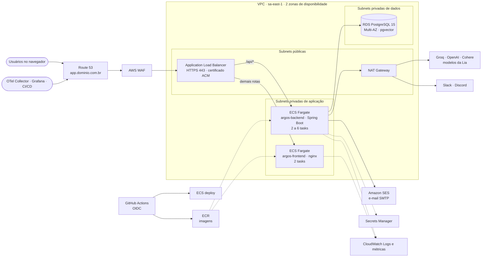

# Argos em produção na AWS (ECS Fargate): mapa e checklist

Este documento descreve como o Argos roda em produção na AWS com **Amazon ECS (Fargate)**. Ele traz a arquitetura alvo, a configuração de cada peça e a checklist de go-live. A primeira seção lista o que precisa mudar no código antes do deploy.

---

## 1. Revisão do código para produção

### 1.1 Bloqueadores (corrigir antes do primeiro deploy)

| # | Problema | Por que bloqueia no ECS | Correção proposta |
|---|---|---|---|
| B1 | A chave RSA que assina o JWT é gerada em memória a cada inicialização (`identity/config/SecurityConfig`). | Com 2 ou mais tasks atrás do ALB, um token emitido por uma task é recusado pela outra (401 aleatório), e todo deploy desloga todo mundo. | Carregar a chave (par RSA em PEM, ou um segredo HMAC) do **Secrets Manager** por variável de ambiente; manter a geração em memória só como fallback de desenvolvimento. |
| B2 | Não há endpoint de saúde sem autenticação no backend. | O ALB e o ECS precisam de um `GET` que responda 200 para saber se a task está saudável. | Adicionar `spring-boot-starter-actuator` com `/actuator/health` (liveness e readiness) liberado no Spring Security e só ele exposto. |
| B3 | Local e nos testes o banco usa o superusuário `postgres`, que **ignora o RLS**. | No RDS a aplicação deve usar um usuário comum, e aí o RLS passa a valer de verdade. Fluxos que não definem o tenant podem falhar ou retornar vazio. | Criar o papel `argos_app` (sem `BYPASSRLS`, sem superusuário) e rodar a suíte completa e um teste manual em staging com ele antes do go-live. |
| B4 | A telemetria (spans, logs, métricas) não tem retenção. | As tabelas `telemetry_*` crescem sem limite no RDS (custo e performance). | Job de retenção (por exemplo, apagar dados com mais de 7 a 15 dias em lotes) ou particionamento por dia. |

### 1.2 Importantes (corrigir antes de abrir para clientes)

| # | Item | Correção proposta |
|---|---|---|
| I1 | Indexação da base da Lia na subida de cada task: duas tasks subindo juntas podem indexar o mesmo documento ao mesmo tempo. | Proteger a indexação com um *advisory lock* do PostgreSQL (`pg_try_advisory_lock`). Até lá, o efeito é só uma falha seguida de nova tentativa automática. |
| I2 | `spring.jpa.show-sql=true` por padrão. | Em produção, `SPRING_JPA_SHOW_SQL=false`. |
| I3 | Cadastro de organização (`/api/auth/register`) e ingestão de webhooks sem limite de taxa. | Regras de *rate limit* no **AWS WAF** para `/api/auth/*` e `/api/webhooks/*`. |
| I4 | O nginx do frontend encaminha `/api` para `http://backend:8081` (nome do docker-compose) com `proxy_read_timeout 60s`. | No ECS, o ALB roteia `/api/*` direto para o backend (seção 5) e o nginx serve só o SPA. Se o proxy do nginx for mantido, usar o ECS Service Connect e subir o timeout para 130 s. |
| I5 | A chave do Groq foi colada em uma conversa durante o desenvolvimento. | **Revogar e gerar outra** antes de produção; nunca reutilizar chaves de desenvolvimento. |
| I6 | Token de sessão com 1 hora e sem refresh token. | Aceitável para o lançamento; avaliar refresh token depois. |

### 1.3 Já está pronto para produção

- Imagens Docker multi-stage (backend em JRE 21 enxuta com `MaxRAMPercentage=75` e usuário sem privilégio; frontend em nginx).
- Configuração 100% por variáveis de ambiente (12-factor); nenhuma chave no código.
- Flyway com lock no banco: várias tasks subindo juntas aplicam as migrations uma única vez.
- Monitor SLO disparado na ingestão (sem `@Scheduled`), seguro com várias tasks.
- Logs em stdout, com formato JSON via `LOGGING_STRUCTURED_FORMAT_CONSOLE=ecs`.
- Lia degrada sozinha: sem embeddings vira busca textual; sem modelo de linguagem, mostra os trechos; fallback entre provedores; retry, circuit breaker e bulkhead.
- Requests em virtual threads (Java 21).

---

## 2. Arquitetura alvo



### 2.1 Componentes

| Componente | Serviço AWS | Configuração inicial |
|---|---|---|
| DNS | Route 53 | Zona do domínio; registro `app` (alias para o ALB) |
| Certificado TLS | ACM | Certificado para `app.dominio.com.br` na mesma região do ALB |
| Proteção de borda | AWS WAF | Regras gerenciadas da AWS + rate limit em `/api/auth/*` e `/api/webhooks/*` |
| Balanceador | ALB | HTTPS 443 (HTTP 80 redireciona), **idle timeout 130 s** (streaming da Lia) |
| Frontend | ECS Fargate | Imagem `argos-frontend` (nginx), 0,25 vCPU / 0,5 GB, 2 tasks |
| Backend | ECS Fargate | Imagem `argos-backend`, 1 vCPU / 2 GB, mínimo 2 tasks, auto scaling até 6 |
| Banco | RDS PostgreSQL 15 | `db.t4g.medium` ou maior, Multi-AZ, 100 GB gp3 com autoscaling de storage, backups 7 dias + PITR, extensão `vector` |
| Segredos | Secrets Manager | Credenciais do banco, chave do JWT, chaves de IA, SMTP |
| Imagens | ECR | Repositórios `argos-backend` e `argos-frontend`, scan on push, lifecycle de 30 imagens |
| Saída para a internet | NAT Gateway | Um por AZ (ou um único para reduzir custo, aceitando o risco) |
| E-mail | Amazon SES | Domínio verificado; credenciais SMTP no Secrets Manager |
| Logs e métricas | CloudWatch | Log groups por serviço (30 dias), Container Insights, alarmes |

### 2.2 Fluxos principais

- **Console:** navegador → Route 53 → WAF → ALB → frontend (SPA); chamadas `/api/*` → ALB → backend → RDS.
- **Ingestão:** OTel Collector, Grafana e CI/CD → `https://app.dominio.com.br/api/webhooks/*` com `X-API-Key` → backend → RDS.
- **Lia:** backend → busca híbrida no RDS (pgvector) → modelos externos (Groq/OpenAI/Cohere) pela NAT → streaming SSE de volta pelo ALB.
- **Notificações:** backend → Slack/Discord pela NAT; e-mail via SES.

---

## 3. Rede e segurança de acesso

### 3.1 VPC

- Região: **sa-east-1 (São Paulo)**, pela latência e pela LGPD.
- 2 AZs; por AZ: 1 subnet pública (ALB, NAT), 1 privada de aplicação (ECS), 1 privada de dados (RDS).
- VPC endpoints recomendados (economizam NAT e aumentam a segurança): ECR (api e dkr), S3 (gateway), CloudWatch Logs e Secrets Manager.

### 3.2 Security groups

| Security group | Entrada permitida | Origem |
|---|---|---|
| `sg-alb` | 443 e 80 | Internet (0.0.0.0/0), filtrada pelo WAF |
| `sg-frontend` | 80 | `sg-alb` |
| `sg-backend` | 8081 | `sg-alb` (e `sg-frontend`, se o proxy do nginx for mantido) |
| `sg-rds` | 5432 | `sg-backend` |

Nenhuma task recebe IP público; o RDS não é acessível pela internet.

---

## 4. Banco de dados (RDS PostgreSQL + pgvector)

1. Criar o RDS PostgreSQL **15** (mesma versão do desenvolvimento) em Multi-AZ, com criptografia KMS, backups automáticos e PITR.
2. Parameter group: `rds.force_ssl=1`; `log_min_duration_statement=500` (consultas lentas).
3. Conectado com o usuário mestre, criar a extensão e o papel da aplicação:

   ```sql
   CREATE EXTENSION IF NOT EXISTS vector;          -- exige rds_superuser, por isso antes da aplicação
   CREATE ROLE argos_app LOGIN PASSWORD '<do Secrets Manager>' NOSUPERUSER NOBYPASSRLS;
   GRANT CONNECT ON DATABASE argos TO argos_app;
   GRANT USAGE, CREATE ON SCHEMA public TO argos_app;
   ```

   O `argos_app` é dono das tabelas criadas pelo Flyway. O `FORCE ROW LEVEL SECURITY` das migrations faz o RLS valer inclusive para o dono.
4. A aplicação conecta com `argos_app` e TLS (`?sslmode=require`).
5. Pool de conexões: com N tasks, `N × maximumPoolSize` precisa caber em `max_connections` do RDS (com margem). Começar com `SPRING_DATASOURCE_HIKARI_MAXIMUM_POOL_SIZE=15`.
6. Migrations: rodam sozinhas na subida (Flyway com lock). Em mudanças destrutivas, rodar antes por uma task avulsa (`aws ecs run-task`).

---

## 5. ALB e roteamento

| Prioridade | Regra | Destino | Health check |
|---|---|---|---|
| 1 | Path `/api/*` | Target group `tg-backend` (porta 8081) | `GET /actuator/health` → 200 (depende do B2) |
| padrão | Demais caminhos | Target group `tg-frontend` (porta 80) | `GET /` → 200 |

- Listener 80 redireciona para 443.
- **Idle timeout: 130 s.** O padrão de 60 s corta as respostas longas da Lia em streaming.
- Deregistration delay de 30 s no backend, para os deploys não cortarem requests em andamento.
- Com o ALB roteando `/api/*`, o navegador continua chamando a mesma origem: não é preciso CORS.

---

## 6. ECS

### 6.1 Cluster e serviços

- Cluster `argos-prod` com Fargate (e Fargate Spot opcional para o frontend), Container Insights ligado.
- **Serviço `argos-backend`:** desired 2, mínimo 2, máximo 6; auto scaling por CPU média de 60% e por `RequestCountPerTarget`; deployment circuit breaker com rollback automático; `minimumHealthyPercent=100`, `maximumPercent=200`; health check grace period de 90 s (Spring + Flyway + indexação da Lia).
- **Serviço `argos-frontend`:** desired 2; mesmo esquema de deploy.

### 6.2 Task definition do backend

- CPU 1024, memória 2048 (o JVM usa 75% via `MaxRAMPercentage`).
- Porta 8081; logs `awslogs` para `/ecs/argos-backend`.
- Task role com acesso só aos segredos do Argos e ao SES; execution role com ECR, CloudWatch e Secrets Manager.
- Health check: o do target group do ALB (seção 5) basta. Para um health check também no container, a imagem precisa ter `curl` ou `wget`.
- `stopTimeout` de 35 s: o Spring Boot já encerra de forma graciosa por padrão (até 30 s para terminar as requisições em andamento).

### 6.3 Variáveis de ambiente e segredos do backend

| Variável | Tipo | Valor ou origem |
|---|---|---|
| `SPRING_DATASOURCE_URL` | env | `jdbc:postgresql://<endpoint-rds>:5432/argos?sslmode=require` |
| `SPRING_DATASOURCE_USERNAME` | secret | `argos_app` |
| `SPRING_DATASOURCE_PASSWORD` | secret | Secrets Manager (com rotação) |
| `SPRING_JPA_SHOW_SQL` | env | `false` |
| `SPRING_DATASOURCE_HIKARI_MAXIMUM_POOL_SIZE` | env | `15` |
| `LOGGING_STRUCTURED_FORMAT_CONSOLE` | env | `ecs` (logs JSON no CloudWatch) |
| `ARGOS_CONSOLE_URL` | env | `https://app.dominio.com.br` (links das notificações) |
| `ARGOS_MAIL_FROM` | env | `noreply@dominio.com.br` |
| `SMTP_HOST`, `SMTP_PORT`, `SMTP_AUTH`, `SMTP_STARTTLS` | env | Endpoint SMTP do SES, `587`, `true`, `true` |
| `SMTP_USER`, `SMTP_PASS` | secret | Credenciais SMTP do SES |
| JWT (chave de assinatura) | secret | Depende do B1 (por exemplo, `ARGOS_JWT_PRIVATE_KEY` e `ARGOS_JWT_PUBLIC_KEY` em PEM) |
| `ARGOS_LLM_PRIMARY_PROVIDER`, `_BASE_URL`, `_MODEL`, `_REASONING_EFFORT` | env | Modelo principal da Lia |
| `ARGOS_LLM_PRIMARY_API_KEY` | secret | Chave do provedor principal |
| `ARGOS_LLM_FALLBACK1..3_*` | env + secret | Fallbacks, de **provedores diferentes** (uma cota não derruba todos) |
| `OPENAI_API_KEY` | secret | Embeddings `text-embedding-3-small` |
| `COHERE_API_KEY` | secret | Rerank (recomendado em produção) |
| `ARGOS_HELPDESK_KB_LOCATION` | env | Opcional; padrão `classpath:knowledge-base/` (documentos dentro da imagem) |

O frontend não precisa de variáveis com o ALB roteando `/api/*`.

### 6.4 Modelos da Lia em produção

- Não usar o plano gratuito do Groq como único provedor: o limite de 8 mil tokens por minuto, compartilhado entre os modelos, derruba a Lia sob uso real.
- Sugestão: principal em um provedor pago (Groq pago, OpenAI ou Anthropic) e fallbacks em outros dois provedores.
- Configurar alertas de gasto em cada provedor.

---

## 7. CI/CD (GitHub Actions → ECR → ECS)

1. **Autenticação sem chaves fixas:** provedor OIDC do GitHub no IAM e role `github-deploy`, restrita ao repositório, à branch `main` e aos recursos do Argos.
2. **Pipeline na `main`:**
   1. Testes do backend (`./mvnw verify`, com Testcontainers e pgvector) e do frontend (`npm run lint && npm run build`), como no CI atual.
   2. Build das imagens com tag = SHA do commit; push para o ECR.
   3. Atualização das task definitions com a nova imagem (`aws-actions/amazon-ecs-render-task-definition`).
   4. Deploy dos serviços (`aws-actions/amazon-ecs-deploy-task-definition`, com `wait-for-service-stability`).
   5. Smoke test: `GET /actuator/health` e `GET /`.
3. **Ambientes:** `staging` (deploy automático) e `production` (aprovação manual no GitHub Environments).
4. **Rollback:** o circuit breaker do ECS volta sozinho quando as tasks novas não ficam saudáveis; manualmente, apontar o serviço para a task definition anterior.

O Argos também pode registrar os próprios deploys: um passo final no pipeline chama `POST /api/webhooks/deploys`, e o Quality Gate (`GET /api/webhooks/deploys/quality-gate`) pode bloquear o deploy de produção.

---

## 8. Observabilidade e alarmes

| Alarme | Condição | Ação |
|---|---|---|
| Backend sem tasks saudáveis | `HealthyHostCount` do `tg-backend` < 2 por 3 min | Página o plantão |
| Erros 5xx no ALB | `HTTPCode_Target_5XX_Count` > 1% das requisições por 5 min | Página o plantão |
| Latência | `TargetResponseTime` p95 > 2 s por 10 min (fora de `/api/support/ask/stream`) | Aviso |
| CPU do backend | Média > 80% por 10 min | Aviso (verificar auto scaling) |
| RDS CPU | > 80% por 15 min | Aviso |
| RDS storage | `FreeStorageSpace` < 15% | Aviso (telemetria crescendo) |
| RDS conexões | > 80% de `max_connections` | Aviso (pool) |
| Lia degradada | Logs `helpdesk.answer` com `outcome=DEGRADED` acima do normal (metric filter) | Aviso (cota ou provedor de IA) |

- Logs: log groups `/ecs/argos-backend` e `/ecs/argos-frontend`, retenção de 30 dias, JSON (`ecs`) para consultar no Logs Insights por `traceId`.
- Os traces por etapa da Lia (Micrometer Observation) podem ir para o X-Ray ou para o próprio Argos via OpenTelemetry numa etapa futura.

---

## 9. Segurança e LGPD

- Segredos só no Secrets Manager, injetados pela task definition; nada em variáveis de texto do console da AWS nem no repositório.
- IAM de menor privilégio para task role, execution role e role do GitHub.
- RDS e volumes criptografados (KMS); TLS do navegador ao ALB e do backend ao RDS.
- WAF com regras gerenciadas (AWS Managed Rules Common, Known Bad Inputs, IP Reputation) e rate limit.
- Dados pessoais: a telemetria já é mascarada na entrada; as perguntas à Lia são mascaradas antes de ir aos provedores de IA. Os provedores de IA ficam fora do Brasil: registrar isso na política de privacidade.
- Backups com retenção definida e restauração testada.
- Revogar a chave do Groq usada no desenvolvimento (I5) e gerar chaves exclusivas para produção.

---

## 10. Checklist de go-live

### Código
- [ ] B1: chave do JWT vinda do Secrets Manager (nada gerado na subida).
- [ ] B2: `/actuator/health` com liveness e readiness, liberado sem autenticação.
- [ ] B3: suíte completa e teste manual com o papel `argos_app` (RLS valendo).
- [ ] B4: retenção da telemetria.
- [ ] I1: advisory lock na indexação da Lia.
- [ ] Merge na `main` com o CI verde.

### Conta e rede
- [ ] Conta AWS de produção separada (ou OU própria), MFA no root, CloudTrail ligado.
- [ ] Budget e alertas de custo configurados.
- [ ] VPC em sa-east-1 com 2 AZs, subnets públicas, privadas de aplicação e de dados.
- [ ] NAT Gateway e VPC endpoints (ECR, S3, Logs, Secrets Manager).
- [ ] Security groups conforme a seção 3.2.

### Banco
- [ ] RDS PostgreSQL 15 Multi-AZ criptografado, backups 7 dias + PITR.
- [ ] `rds.force_ssl=1` no parameter group.
- [ ] Extensão `vector` criada; papel `argos_app` sem `BYPASSRLS`.
- [ ] Teste de restauração de backup feito.

### Segredos e configuração
- [ ] Segredos no Secrets Manager: banco, JWT, SMTP, chaves de IA (principal + fallbacks + OpenAI + Cohere).
- [ ] Chaves de IA exclusivas de produção, com limites de gasto nos provedores.
- [ ] Chave do Groq de desenvolvimento revogada.
- [ ] SES com domínio verificado e fora do sandbox.

### Imagens e ECS
- [ ] Repositórios ECR com scan on push e lifecycle.
- [ ] Task definitions do backend e do frontend com logs, health check e segredos.
- [ ] Serviços com circuit breaker, auto scaling e grace period de 90 s.
- [ ] `stopTimeout` (35 s) e deregistration delay (30 s) ajustados.

### Borda
- [ ] Certificado ACM emitido e validado.
- [ ] ALB com HTTPS, redirect 80→443, idle timeout 130 s, regras `/api/*` e padrão.
- [ ] WAF associado ao ALB, com rate limit em `/api/auth/*` e `/api/webhooks/*`.
- [ ] Registro DNS no Route 53 apontando para o ALB.

### CI/CD
- [ ] OIDC GitHub → AWS e role de deploy restrita.
- [ ] Workflow de build, push e deploy para staging; produção com aprovação manual.

### Observabilidade
- [ ] Log groups com retenção e logs em JSON (`LOGGING_STRUCTURED_FORMAT_CONSOLE=ecs`).
- [ ] Alarmes da seção 8 criados e com destino (e-mail, Slack ou PagerDuty).
- [ ] Container Insights ligado.

### Validação final (staging, depois produção)
- [ ] Criar organização, entrar, criar usuário Editor e Leitor e conferir as permissões.
- [ ] Gerar chave de API e enviar telemetria pelo assistente Conectar App (aparece na Telemetria).
- [ ] Monitor SLO abre e resolve um incidente com erros simulados.
- [ ] Alerta pelo webhook abre incidente e o resolvido o encerra.
- [ ] Canais de Slack, Discord e e-mail recebem o teste.
- [ ] Registrar deploy e consultar o Quality Gate (200 e 409).
- [ ] KPI cadastrado mostra impacto em R$ no incidente.
- [ ] Lia: base indexada (22 documentos), resposta com fontes, fora do escopo recusado, prompt injection bloqueado, streaming sem corte por mais de 60 s.
- [ ] Deploy de uma versão nova sem deslogar ninguém (valida o B1) e sem erros 5xx.
- [ ] Rollback testado (voltar para a task definition anterior).

---

## 11. Custos: o que mais pesa

- **NAT Gateway** (hora + dados processados), sobretudo com telemetria e chamadas de IA; os VPC endpoints reduzem o tráfego pela NAT.
- **RDS Multi-AZ**, que dobra o custo da instância; a retenção da telemetria (B4) controla o storage.
- **Fargate** do backend (2 tasks fixas + picos).
- **ALB** e **WAF** (por hora e por requisição ou regra).
- **Provedores de IA** (tokens), fora da fatura da AWS.

Use a AWS Pricing Calculator com esses componentes para a estimativa mensal. Para reduzir custo em ambientes que não são de produção: RDS single-AZ, um único NAT, Fargate Spot e serviços desligados fora do horário.
